<div align="center">


# Tell Liora

**Know when to go, even with no signal.**

An offline AI companion for Filipino mothers. She tells Liora how she feels in Tagalog, English or
Taglish. Gemma 4 runs on her iPhone, and rules written from WHO guidance tell her whether to go to
the hospital now, go to the health centre soon, or wait.


[**Watch the 30-second film with sound**](docs/media/tell-liora-launch.mp4) ·
[How it works](#how-it-works) · [Safety](#safety-by-design) · [Run it](#run-it)

</div>

## The moment it's built for

In the Philippines, a pregnant woman goes to the health centre herself; nobody visits her. So the
hard moment happens at home. It's 2 AM, she's 32 weeks pregnant, she has a bad headache and blurry
vision. The centre is closed, she has no load or signal, and she doesn't want to wake anyone over
something that might be nothing. Today she guesses, searches online, asks a Facebook group, or waits
until morning.

Tell Liora gives her an answer on the phone itself, at any hour, and keeps her cycle, symptom and
mood log beside it. Context, from checked sources:

- After the late-2024 storms, birthing facilities in Bato, Bula and Nabua (Camarines Sur) closed
  temporarily, and flooding damaged medicines and emergency transport
  ([UNFPA Philippines, Dec 2024](https://unfpa.org/sites/default/files/resource-pdf/UNFPA%20Philippines%20Situation%20Report%20%231_%20Overlapping%20Tropical%20Cyclones.pdf)).
- In a 2026 survey, 69% of pregnant and 62% of postpartum respondents scored 13 or more on the
  EPDS depression screen, and only 2 of 500 postpartum respondents had received counselling. The
  sample was mostly recruited through Facebook ads and is not nationally representative
  ([Filoteo et al., BMJ Open, Feb 2026](https://www.ncbi.nlm.nih.gov/pmc/articles/PMC12918685/)).

## Screens

Every image is an unedited screenshot of the app running on an iPhone.

<table>
  <tr>
    <td align="center" width="25%">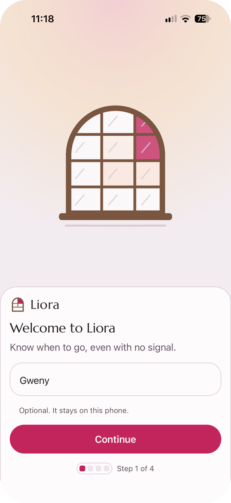<br /><sub><b>Welcome</b><br />Her name stays on the phone</sub></td>
    <td align="center" width="25%">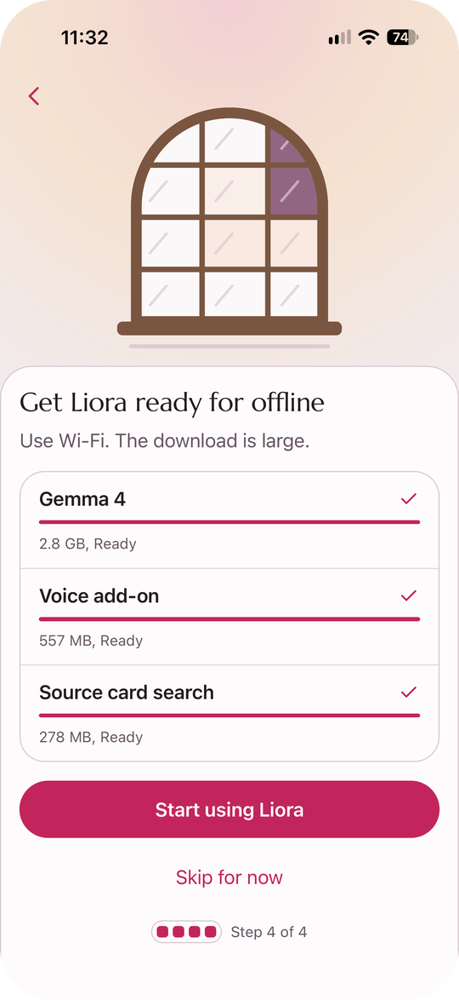<br /><sub><b>Offline setup</b><br />One download on Wi-Fi, then no signal needed</sub></td>
    <td align="center" width="25%">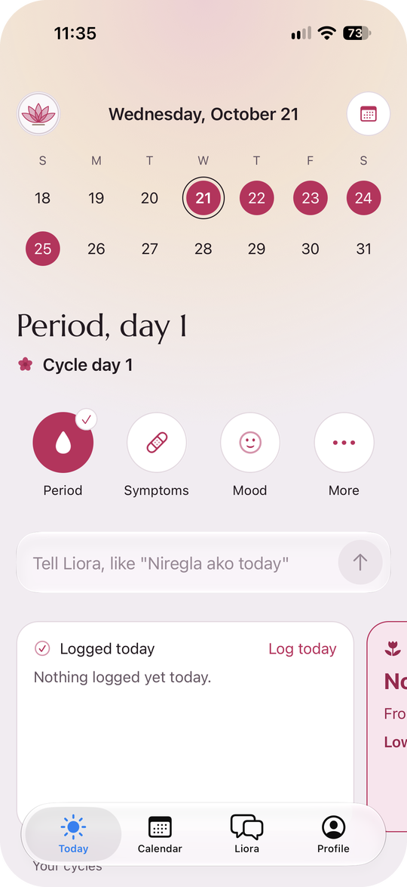<br /><sub><b>Today</b><br />Her day, quick logs and the Tell Liora bar</sub></td>
    <td align="center" width="25%">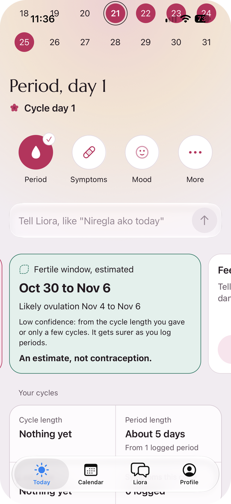<br /><sub><b>Cycle estimates</b><br />Each one says how sure it is</sub></td>
  </tr>
  <tr>
    <td align="center">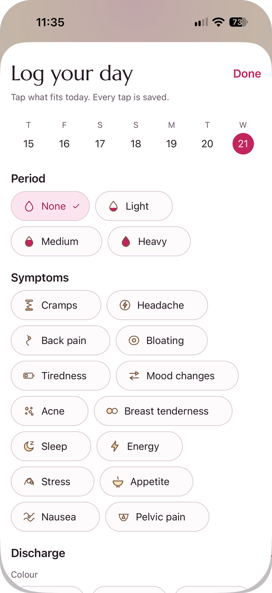<br /><sub><b>Log your day</b><br />Flow, symptoms, discharge, moods, activities</sub></td>
    <td align="center">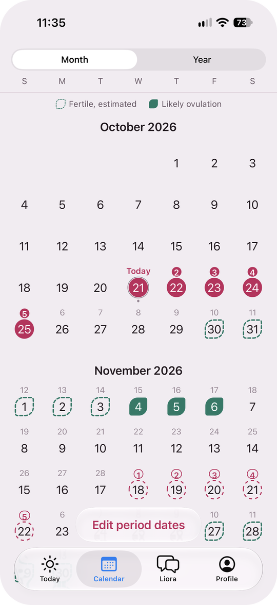<br /><sub><b>Calendar</b><br />Logged days fill in, estimates stay dashed</sub></td>
    <td align="center">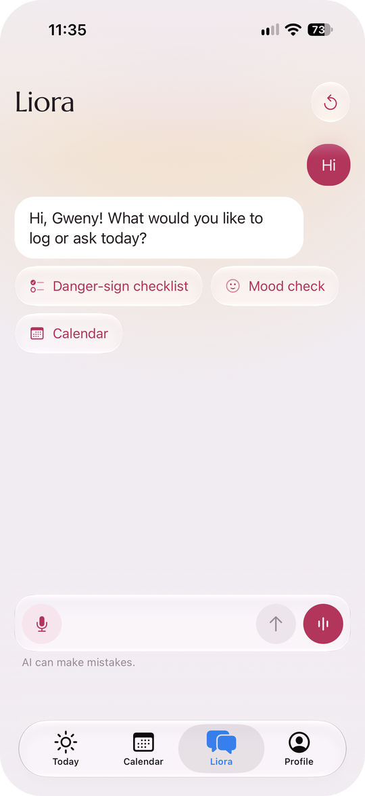<br /><sub><b>Liora chat</b><br />Taglish in, with the danger-sign checklist one tap away</sub></td>
    <td align="center">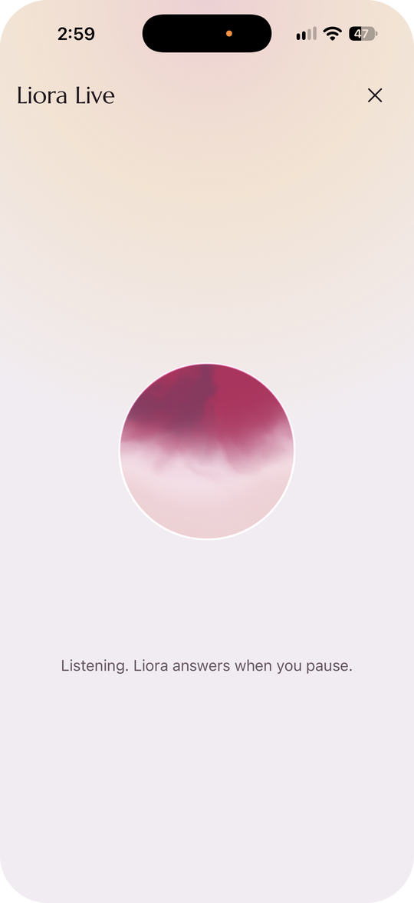<br /><sub><b>Liora Live</b><br />Hands-free voice, on the phone</sub></td>
  </tr>
  <tr>
    <td align="center">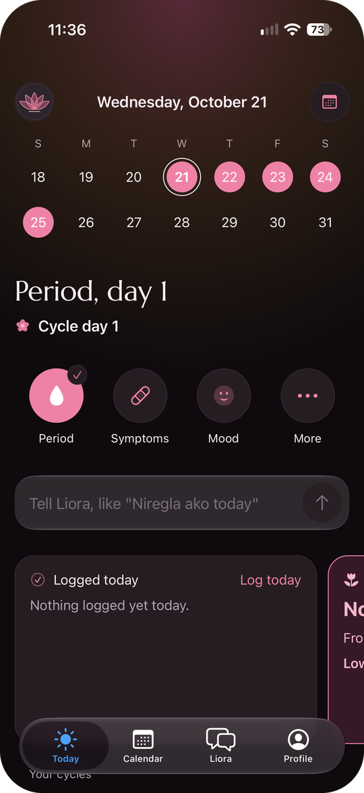<br /><sub><b>Today</b>, dark</sub></td>
    <td align="center">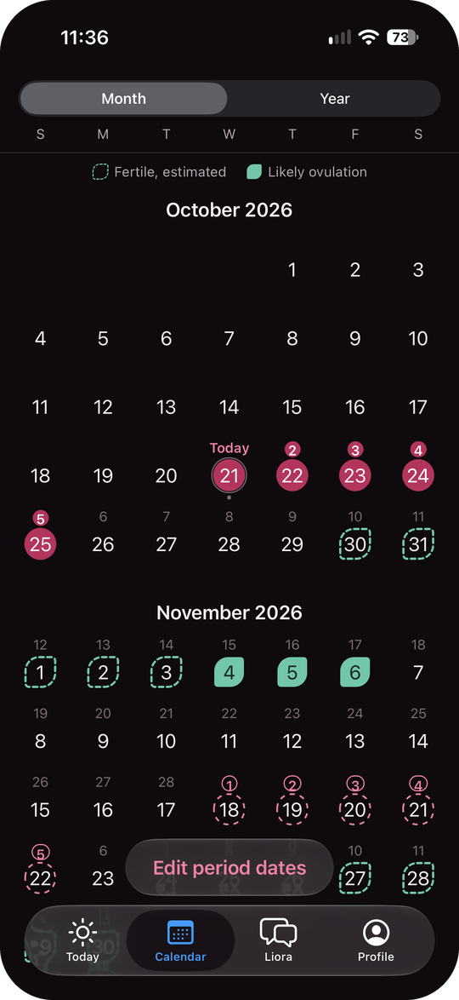<br /><sub><b>Calendar</b>, dark</sub></td>
    <td align="center">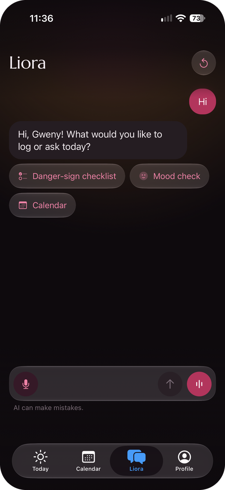<br /><sub><b>Liora</b>, dark</sub></td>
    <td align="center">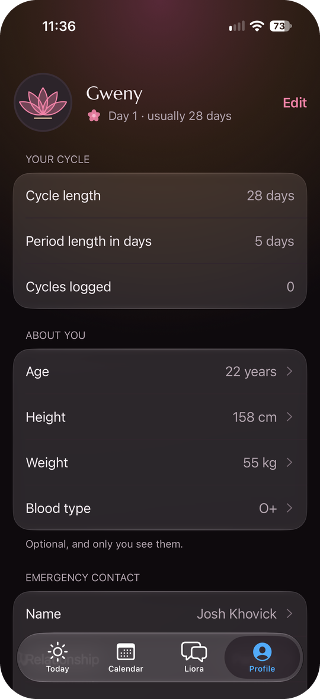<br /><sub><b>Profile</b>, dark</sub></td>
  </tr>
</table>

## How it works

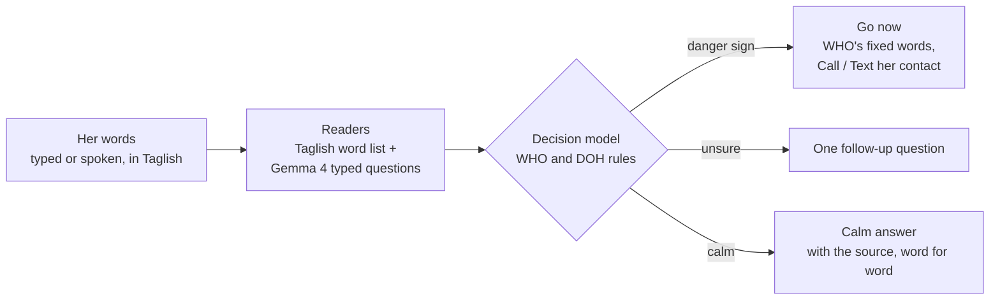

| Step | What happens |
| --- | --- |
| **Listen** | She types, or speaks for up to 30 seconds. Gemma 4's own audio encoder writes down her words, and she can fix them before sending. |
| **Understand** | Readers turn her words into danger-sign codes: a Taglish word list, and Gemma 4 answering fixed, typed questions ("Does the message say she has bleeding from the vagina?") with a confidence for each answer. On a calm answer, EmbeddingGemma finds the reviewed source card closest in meaning. |
| **Decide** | A deterministic decision model built from WHO and DOH warning-sign tables makes the call: go to the hospital now, one fixed follow-up question, or a calm answer. |
| **Explain** | Fixed, pre-written screens; a card to show the nurse; and the WHO or DOH passage behind the answer, shown word for word. |
| **Remember** | Her log, a cycle calendar and an explained next-period estimate, stored only on her phone. |
| **Act** | Liora is an agent: "Niregla ako today, masakit puson ko" saves her period start and symptom at once, with Undo. The word rules read her message first; Gemma fills gaps by choosing from closed action lists (never writing dates or medical text); clear logs are saved, anything that would replace data or change her status waits for her tap. It works the same in the chat, in hands-free Liora Live and from Today. |
| **Companion** | The reply is built from fixed copy, what was saved, her own logs, a quoted source card or the rules' decision, opened by one guarded warm sentence on calm turns. On a danger sign, nothing else happens: the go-now screen and nurse card. |

**The AI only understands her words. Every decision comes from transparent rules she can see.**

### Jev-style typed decisions, on the phone

[Jev](https://typesafe.ai/), from TypeSafe AI, is a decision model that answers typed questions
(pick one option, score on a scale, or yes/no) with a confidence instead of generating text. It
runs only as a cloud service, so Tell Liora uses the same idea locally: Gemma 4 reads her message
once, and each question is answered by reading the probabilities of its listed options only (the
open [SemIf](https://github.com/TheoLeeCJ/SemIf-OpenJev) method). Nothing outside the options can
come back. If the model is unsure about a danger sign, Liora asks the follow-up question instead of
guessing. We make no claim that this matches Jev's accuracy.

## Safety by design

- **The AI never decides.** Every "go now", "as soon as possible", follow-up and calm outcome comes
  from rule tables, each with a WHO or DOH source. In pregnancy the rules follow the two lists of
  WHO's *Pregnancy, childbirth, postpartum and newborn care* guide (M2, p. 163): "go to the hospital
  or health centre immediately" and "go to the health centre as soon as possible", and a fever gets
  WHO's own question ("Are you too weak to get out of bed?") before either.
- **Caution only goes up.** A danger sign found by any reader counts. Skipping the follow-up
  question counts as the serious case. The AI can never talk her out of a follow-up on its own: its
  "mild" reading counts only when her own words say so ("medyo", "konti").
- **No AI-written medical text.** The "go now" and crisis screens use fixed copy. The urgent lines
  quote approved WHO passages word for word, and source cards are shown verbatim, never paraphrased.
  Gemma answers yes/no questions with probabilities and picks actions from closed lists. On calm
  turns it only rephrases Liora's fixed line in English, and its version is shown only if it keeps
  the line's numbers and most of its words and passes a filter for medical advice, diagnosis,
  medicine, reassurance and prompt leaks; otherwise the fixed line shows. On a danger turn it writes
  nothing, and health facts only ever come from the reviewed cards, shown word for word.
- **It does not let go.** After a go-now, a calm message ("Kaya ko pa naman") keeps the go-now and
  her **Call / Text** buttons in view. When she is not pregnant, signs that should not wait for
  anyone (losing sight, fits, fainting, blue lips, a severe headache, belly pain or breathing
  trouble) get a fixed "do not wait" line and her contact.
- **Her words are data, never instructions.** Attempts to change Liora's rules or reveal its prompt
  get a fixed line, with no model call and no writes.
- **Works without the AI.** If the model cannot load, "AI off, checklist on" lets her tap her signs,
  and the same rules decide.
- **Not a medical device.** Liora doesn't diagnose or prescribe; it helps her decide when to go.
  There is no medicine advice, no diagnosis from photos of her body, and no birth-control advice.
  The fertile window is an estimate, hidden when her cycles vary widely, labelled "An estimate,
  not contraception.", with its sources (Bull et al. 2019; Wilcox et al. 1995).
- **Private.** No account, no server, no analytics. After the first download the app makes no
  network requests, and "Delete everything" wipes all of her data.

## Features

"Checked on the iPhone 17 Pro" means seen working on the demo phone on 10 Oct 2026; "built" means
built and tested in code (2,100+ automated tests) but not confirmed on the phone.

| Feature | Status |
| --- | --- |
| Gemma 4 E2B on the iPhone: download, load on the GPU, typed decisions, fully offline | checked on the iPhone 17 Pro |
| Liora chat agent: logs periods, flow, symptoms and moods from Taglish, with Undo; answers from her logs | checked on the iPhone 17 Pro |
| Liora Live: hands-free voice with Gemma 4's audio encoder and silence detection | checked on the iPhone 17 Pro |
| "Go to the hospital now" card with WHO's fixed words and Call / Text her emergency contact | checked on the iPhone 17 Pro |
| One question first: comfort line and the follow-up for an unsure sign | checked on the iPhone 17 Pro |
| Skip counts as serious, shown calmly as "Let's be safe" with a way back to the question | built |
| Nurse handoff report: her details, blood type, her words, signs, WHO rule and citation, last 7 days; Share as PDF | built |
| Cycle calendar: logged period days and the explained next-period estimate | checked on the iPhone 17 Pro |
| Estimated fertile window and likely ovulation, labelled "An estimate, not contraception." | built |
| Today: logged today, cycle stats, patterns | checked on the iPhone 17 Pro |
| "How Liora decided": her words, what each reader found, which rule fired, which models ran | checked on the iPhone 17 Pro |
| WHO's two lists: "as soon as possible" screen with the WHO passage, and the fever question | built |
| Replies that follow her mood (upbeat or gentle) and answer in her language | built |
| Prompt-injection and leak guardrails | built |
| Sources screen: every WHO and DOH document, its passages and the official link | built |
| Face ID lock on every tab, with "Check danger signs" open without unlocking | built |
| Private mood check (PHQ-9), with the NCMH crisis hotline on any self-harm answer | built |
| AI-off checklist, feeding the same WHO rules | built |
| Profile: name, age, height, weight, blood type, emergency contact, pregnancy or after-birth status | built |
| Source-card search by meaning (EmbeddingGemma 300M, on the phone) | built |
| Native iPhone tabs with Liquid Glass, SF Symbols, wheel pickers, share sheet, haptics and dark mode | built |

## Why run the AI on the phone?

It works when there is no signal or load: at night, in a typhoon, in airplane mode. Her questions
about her body, her pregnancy and her mood never leave her phone. And with no per-question cost,
Liora can stay free for every mother.

## Models

All models run on the device through [llama.rn](https://github.com/mybigday/llama.rn) 0.13.0-rc.7
(llama.cpp, on the iPhone's GPU with Metal). The model file is mapped from storage instead of being
copied into memory. Sizes are Hugging Face file sizes, not our measurements.

| Role | Model | Licence | File |
| --- | --- | --- | --- |
| Typed decisions on her words | [Gemma 4 E2B instruct, Q4_0](https://huggingface.co/ggml-org/gemma-4-E2B-it-GGUF) | Apache-2.0 | 2,709 MiB |
| Speech to text | Gemma 4 E2B audio encoder (projector, Q8_0) from the same repository | Apache-2.0 | 531 MiB |
| Finding the source card closest in meaning | [EmbeddingGemma 300M, QAT Q4_0](https://huggingface.co/ggml-org/embeddinggemma-300M-qat-q4_0-GGUF) | Apache-2.0 | 264 MiB |

Speed and memory have not been measured on the demo iPhone yet, so this README quotes no timing
numbers. Retrieval only chooses which reviewed card to show; it never decides.

We started in Safari with [Transformers.js](https://github.com/huggingface/transformers.js). It
could not hold Gemma 4 E2B in one tab: iPhone WebGPU caps a buffer at 1,024 MB while Gemma 4's token
embedding table is 1,120 MB, and the library keeps every downloaded file in memory, so the tab was
closed during the download. The native app reads the model from storage, which is how native apps
run it. The web export still builds and keeps the rules, word list and checklist working in a
browser.

## Tech stack

Expo SDK 57 with a native iOS build (Expo prebuild, Xcode 27), Expo Router, React 19.2, React Native
0.86, NativeWind 4.2 with Tailwind 3.4, Reanimated 4.5, Zustand 5, Zod 4, date-fns 4, TypeScript 6.0.
llama.rn runs the models; expo-audio records 16 kHz WAV for speech; expo-file-system holds the model
files; Expo Router native tabs (Liquid Glass), @expo/ui wheel pickers, expo-local-authentication
(Face ID), expo-print and expo-sharing (the nurse report PDF), expo-haptics. Data lives in one JSON
file on the phone (IndexedDB on the web). Tests use Vitest.

The code is split into layers that depend inward only, so the safety rules can be read and tested
without the models or the screens. [ARCHITECTURE.md](ARCHITECTURE.md) explains them, and
[DESIGN.md](DESIGN.md) holds the design system, Capiz Light.

## Run it

```bash
git clone https://github.com/joshfermano/liora-local.git
cd liora-local
pnpm install
pnpm test && pnpm typecheck     # 2,100+ tests: rules, agent, word list, cycle maths, chat
```

**Quick look in Expo Go (no Mac needed).** Run `npx expo start` and scan the code with Expo Go on an
iPhone on the same Wi-Fi. Expo Go cannot run the on-device models, so the app opens with the AI off:
the screens, logging, calendar and the WHO checklist all work, and Liora answers with fixed lines.

**The full app, with Gemma 4.** You need a Mac with Xcode 27, an Apple ID (a free one works) and an
iPhone with Developer Mode on.

```bash
APPLE_TEAM_ID=<your team id> npx expo prebuild -p ios
npx expo run:ios --device --configuration Release
```

On the iPhone, trust the developer once (Settings, General, VPN & Device Management), open Tell
Liora, and choose "Get Liora ready for offline" to download Gemma 4 over Wi-Fi. After that it works
in airplane mode. A free Apple ID cannot sign the Extended Virtual Addressing capability, so the app
asks only for Increased Memory Limit, and a free-signed build stops opening after 7 days until it is
rebuilt. `npx expo export -p web` builds the web version.

## Project structure

| Path | What it is |
| --- | --- |
| `app/` | Screens and routes (Expo Router) |
| `src/core/` | The decision model, cycle maths and agent policy: plain TypeScript, no UI or models |
| `src/ai/` | Gemma 4 and EmbeddingGemma adapters, prompts, voice |
| `src/store/`, `src/ui/`, `src/content/` | App state, building blocks of the screens, fixed copy and source cards |
| `sources/` | The WHO and DOH documents behind every rule, and the team's review of each card |
| `ARCHITECTURE.md`, `DESIGN.md`, `PRODUCT.md` | Layers, the Capiz Light design system, product context |
| `docs/superpowers/specs/` | The build spec: requirements, pipeline, decision model, models |
| `docs/research-summary.md` | Verified facts, refuted claims, open questions |
| `docs/hackathon/` | The hackathon working notes: handoff, submission sheet, demo script, test prompts |
| `AGENTS.md`, `CLAUDE.md`, `.claude/` | Instructions and project subagents for the coding agents used to build it |

## Sources

| Source | Used for |
| --- | --- |
| WHO ANC Digital Adaptation Kit (2021): danger-sign check (p. 73), decision tables ANC.DT.01 and ANC.DT.17 | The danger signs and urgent referral rules |
| WHO Pregnancy, Childbirth, Postpartum and Newborn Care, 3rd edition (2015), M2 and M4 | Source cards, the go-now lines and the calm answer's watch-for list, word for word |
| DOH Mother and Child Book (Philippines) | Source cards, word for word |
| [PHQ-9](https://www.phqscreeners.com/) (Spitzer, Williams, Kroenke and colleagues): "No permission required to reproduce, translate, display or distribute" | The mood check, items word for word; cut-off 10 (Kroenke, Spitzer and Williams 2001) |
| [WHO Philippines and DOH, 10 September 2020](https://www.who.int/philippines/news/detail/10-09-2020-doh-and-who-promote-holistic-mental-health-wellness-in-light-of-world-suicide-prevention-day) | The NCMH Crisis Hotline (1553) on the crisis screen |

Every source card was compared with its page by a team member; each verdict is recorded in
`sources/review.md` (the fact-check commit is 14b0e94), and only approved cards ship. No rule or card
ships without a cited source.

## Built at the AppBuildersPH Hackathon 2026

Tell Liora was built for the [AppBuildersPH Hackathon 2026](https://cerebralvalley.ai/e/appbuildersph-hackathon-2026)
(theme: Local AI) and submitted before the code freeze at 10:00 AM, 10 Oct 2026. The submitted code
is the [`hackathon-submission`](https://github.com/joshfermano/liora-local/tree/hackathon-submission)
tag; later commits are fixes and this page.

**Team Potato:** Josh Khovick Fermano, Ivan Reeve Lopez, Inaki Manuel Flores, Uriel Papa.

**Hardware tested on:** the iPhone 17 Pro (iOS 27.2) as the demo phone, and an iPhone 16 Pro Max for
development testing. Builds on a Mac with Xcode 27; development on Linux and macOS laptops.

### Disclosures

- **Models:** listed above. All run on the device.
- **APIs and cloud services:** none at runtime. Setup downloads the model files from Hugging Face.
- **Runs locally (all of it, in airplane mode):** the Liora chat agent and its replies (Gemma 4
  E2B), voice to text (Gemma 4's audio encoder), source-card search (EmbeddingGemma 300M), the WHO
  rule-based decisions, cycle and fertile-window estimates, the mood check, the nurse report and its
  PDF, Face ID, and all storage.
- **Needs internet:** only the one-time model download at setup (about 3.5 GB from Hugging Face,
  on Wi-Fi). Two things she chooses to do leave the app: "Open the official document" opens the WHO
  or DOH page in Safari, and Call / Text uses the phone's own call and messages apps. (A
  developer-signed build is also checked online by iOS the first time it opens; that is Apple's
  check, not the app's.)
- **Existing code and assets:** no existing code; every source file was written during the
  hackathon. Open-source libraries from npm (listed in `package.json`), the Marcellus font (SIL Open
  Font License, via `@expo-google-fonts`) and Apple's SF Symbols are used as published. The app
  icon and illustrations were drawn during the hackathon. WHO and DOH passages and the PHQ-9 are
  cited third-party content. The typed-decision method follows TypeSafe AI's public description of
  Jev and the open SemIf method; no TypeSafe code or service is used.
- **AI development tools:** [Claude Code](https://claude.com/claude-code) (Anthropic; Claude Opus 5.5,
  with Claude Sonnet 5.5 and Claude Haiku 5.5 subagents), with the agent skills listed in
  `skills-lock.json` and the project subagents in `.claude/agents/`, and
  [Codex](https://openai.com/codex/) (OpenAI). Higgsfield was used for the hackathon demo video's
  story scenes only; every app screen in that video is a real screen recording.
- **The launch film on this page** was made after the hackathon with
  [HyperFrames](https://hyperframes.heygen.com/) from real screenshots of the app. Music: "Digital
  Clouds" by Alejandro Magaña, under the [Mixkit free music licence](https://mixkit.co/license/#musicFree).

## What's next

The decision model, word list, source cards and tests are plain TypeScript and data, shared by the
iPhone app and the web build. Next are measured speed and memory numbers on the demo iPhone, and a
review of the WHO content licences (commonly CC BY-NC-SA) before any commercial use.
